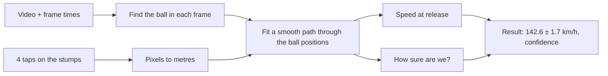

# How cricpro works

*Keep this page up to date: whenever behaviour changes, update it in the same commit.
Last updated for: v0.1.2.*

## The idea in one paragraph
Film one delivery in slow-motion with a phone on a tripod, beside the pitch. Each frame shows where the ball
is. If we know how many pixels equal one metre, and exactly when each frame was taken, then
speed = distance moved / time taken. Everything else exists to make that number accurate and to say how far
off it might be.

## The pipeline

### 1. Frame times
Speed needs real time between frames. A 240 fps phone clip has frames about 4.2 ms apart, but the file's
"fps" label can be wrong (slow-motion clips are often stored as 30 fps). The engine uses real per-frame
timestamps when it has them (the planned in-app recorder will save them) and otherwise the fps you tell it,
and then marks the result as less certain.

### 2. Pixels to metres (calibration)
You tap the bottom and top of the stumps at both ends. We know the stumps are 20.12 m apart and 71.1 cm
tall, so the taps give a scale. We assume the camera looks straight across the pitch ("square-on").

### 3. Finding the ball
The camera is fixed, so anything that changes between frames is moving: the bowler, the ball. We build a
picture of the empty scene (the median of many frames) and look for small bright differences. The ball is a
small blob. This gives a list of candidate dots per frame, mostly junk.

### 4. Picking the real ball path
The ball follows gravity and air drag, so its dots lie on a smooth curve. The program tries many random
curves and keeps the one that explains the most dots at sensible speeds (RANSAC), then fits a smooth curve
through those dots. Dots near the ground are ignored so the bounce doesn't confuse the fit.

### 5. Speed
Read the speed off the fitted curve at the release frame you marked. Because the curve is fitted over many
frames, it can be more precise than counting frames between two points. The *average* speed over the
tracked flight is also shown; it is lower, because the ball slows down in the air.

### 6. How sure are we?
The result shows `± x km/h` (a 95% range) and a confidence label.
- The range comes from repeating the calculation hundreds of times with small random changes to your taps,
  the ball positions and the camera angle, and seeing how much the speed moves.
- The label is HIGH, MEDIUM or LOW from simple checks: enough frames tracked, the curve fits tightly,
  a gravity check passes, fps is high enough, frame timing is trustworthy, and the range is within 1 km/h.

## What can go wrong (known limits)
- **Camera not square-on:** speeds come out wrong by about the scale difference between the two ends and the
  taps cannot reveal it. Fix planned: printed markers.
- **Ball off the centre line:** a ball nearer the camera looks bigger and reads fast. Rough size: offset divided
  by camera distance.
- **Bad light, clutter, or the ball hidden by the bowler's hand** can stop tracking.
- Real footage has not been measured yet; see the test results in docs/journey when we have them.

## The parts of the repo
| Part | What it is |
|---|---|
| `speed-core/cricketspeed/` | the engine (steps 1-6 above) |
| `speed-core/tools/` | desktop helpers: tap picker, batch comparison with a reference speed |
| `speed-core/tests/` | fake-delivery generator and accuracy test |
| `testbench/` | phone-friendly web page to try the engine on real clips |
| `docs/journey/` | the story: decisions, findings, what's next |

## Words used
- **fps**: frames per second.
- **Calibration**: telling the program how big things are in the picture.
- **Release**: the moment the ball leaves the hand.
- **Confidence interval (±)**: the range the true speed is probably inside.
- **Parallax**: things nearer the camera look bigger.
